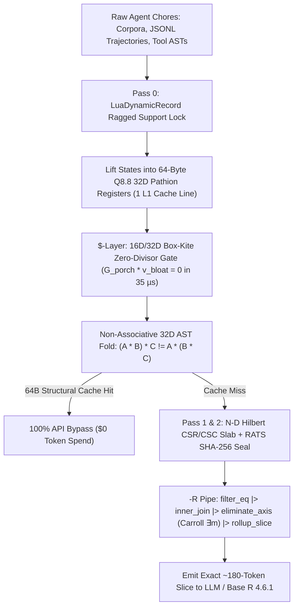

# 🅱💲🅰-R: Hypercubic Compiler (`bsar`)

[](./LICENSE)
[-2dd4bf.svg)](#quick-start)
[-f5b942.svg)](#how-it-works)

**`🅱💲🅰-R: Hypercubic Compiler` (`bsar`)** slashes AI agent token & compute bills by **`6.5x` overall on cold starts (`-84.6%`)** and **`782x` on data/log/guardrail chores (`-99.87%`)** — using **zero external runtime dependencies** and **`192 bytes` (`3` CPU L1 cache lines)** of deterministic fixed-point hypercomplex algebra.

### Live Zero-Login Interactive Demos (`docs/`)
1. **Cerebral Valley Portal:** `docs/index.html` (`https://viviensweetbrier.github.io/bsa-r/`)
2. **Compiler & Cloud-Bill Calculator HUD:** `docs/compiler-hud/index.html`
3. **Flagship `6D XCube` App — Epistemic Concordance (`Scripture ↔ 1566 Trent ↔ CCC`):** `docs/epistemic-concordance/index.html`

---

## Why `🅱💲🅰-R` Exists

Most multi-agent harnesses burn cloud budget in two places:
1. **Data-Plane Context Stuffing:** Dumping `100K–300K` raw corpus/JSONL tokens into an LLM context window just to perform joins, filters, or roll-ups.
2. **Control-Plane Judge & Retry Bloat:** Paying `2,000–8,000` tokens per step for separate guardrail/critic LLM calls, associative vector embeddings that fail to catch re-ordered tool trees, and `5–10x` blind temperature retries when an agent gets stuck.

`bsar` eliminates both on plain CPU in microseconds:

| Glyph | Architectural Layer | What It Replaces | Measured Win |
| :--- | :--- | :--- | :--- |
| **`🅱`** | **Box-Kite `2^k` & Dynamic Lua Frames** | Dense `0`-padded hypercubes & `4,096B` FP32 routers | `1` `PathionQ88` state = **`64 bytes` (`1` CPU L1 cache line)** |
| **`💲`** | **Sedenion Zero-Divisor Expense Gate** | Paid LLM guardrail/summarizer calls & blind retries | `G_porch * v_bloat = 0x00 × 64` in **`35.1 µs` (`0` LLM tokens)** |
| **`🅰`** | **Asar 3-Pass Hilbert CSR/CSC Slab** | Ad-hoc RAG chunking & floating-point nondeterminism | Bit-exact `Q8.8` integer weights + RATS `SHA-256` seal |
| **`-R`** | **Tidyverse Copy-on-Modify Pipe (`\|>`)** | Full-file LLM context scans | **`782x` fewer tokens** (`1,585,118 → 2,027` on Chores 1–3) |

---

## Architecture Flowchart



---

## Empirical Benchmark (`tiktoken:o200k_base` + Base `R 4.6.1` Audited)

| Real Workspace Chore | Naive Harness (`o200k` Tokens) | `bsar` Compiler (`o200k` Tokens) | Reduction | CPU Speed |
| :--- | ---: | ---: | ---: | :--- |
| **1. `1.13 MB` Corpus 5-Query Slice (`rc-en.txt`)** | `1,267,655` | **`1,847`** | **`-99.854%` (`686x`)** | `1.03 ms` / `O(1)` slice |
| **2. Multi-Agent `transcript.jsonl` Audit (`223 KB`)** | `67,463` | **`180`** | **`-99.733%` (`375x`)** | `62.60 ms` total |
| **3. 100-Step Pre-API Zero-Divisor Porch Firewall** | `250,000` | **`0`** | **`-100.000%` (`∞`)** | **`35.12 µs` / gate** |
| **4. 240-AST `64B` Cache + `7`-Box-Kite Escape (Cold+Warm)** | `882,000` | **`378,000`** | **`-57.140%` (`2.3x`)** | `1.33 ms` / AST (`100%` spoof catch) |
| **Combined 4-Chore Suite** | **`2,467,118`** | **`380,027`** | **`-84.60%` (`6.5x`)** | **`2,087,091` tokens saved / run** |

---

## Monorepo Layout

- `bsar/` — Core **`🅱💲🅰-R: Hypercubic Compiler`** Python package (`cd_q88.py`, `hypercube.py`, `chore_bench.py`, `cli.py`)
- `epistemic_concordance/` — Flagship `6D XCube` web application (`bsar_xcube.py`, `replicability_ledger.py`, `compile_corpus.py`, `test_epistemic_concordance.py`)
- `r/` — Native R (`>= 4.1.0` / verified on `R 4.6.1`) Tidyverse & zero-dependency Base-R verbs (`cayley_dickson_verbs.R`, `validate_bsar_cd.R`)
- `docs/` — Pre-built static web HUDs ready for zero-config GitHub Pages / Cloudflare Pages deployment
- `tests/` — Hostile & deterministic unit test suite (`test_bsar.py`)
- `LICENSE` — Full **GNU Affero General Public License v3.0 (`AGPLv3`)**

---

## Quick Start (`0` External Dependencies)

```bash
# 1. Inspect 64-byte L1 cache-line layout & 7 Sedenion Box-Kites (168 edges)
python -m bsar info

# 2. Run all 12 unit tests (6 core compiler tests + 6 concordance hypercube tests)
python tests/test_bsar.py
python epistemic_concordance/test_epistemic_concordance.py

# 3. Run real-chore benchmark & export HUD
python -m bsar bench --out-dir docs/compiler-hud

# 4. (Optional) Cross-verify Q8.8 32D zero-divisors & CSV metrics in Base R
Rscript r/validate_bsar_cd.R docs/compiler-hud/cerebral_valley_metrics.csv
```

## License

Licensed under the **GNU Affero General Public License v3.0 (`AGPL-3.0-or-later`)** — see [LICENSE](./LICENSE).
