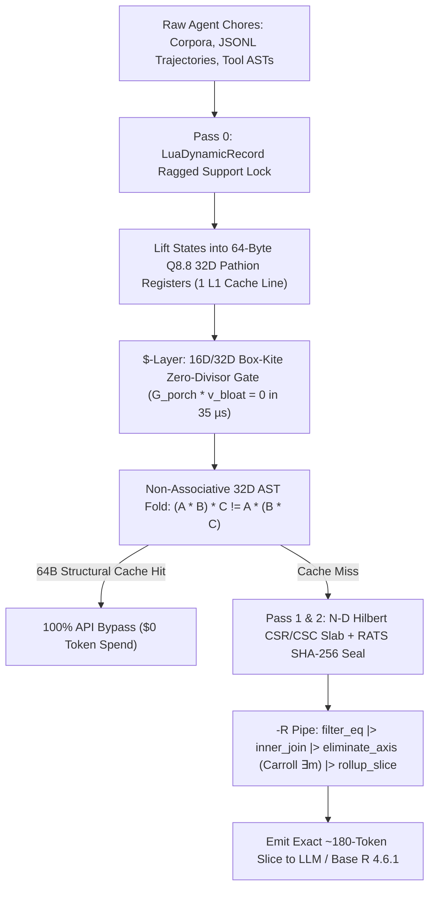

# 🅱💲🅰-R: Hypercubic Compiler (`bsar`)

[](./LICENSE)
[-2dd4bf.svg)](#quick-start)
[-f5b942.svg)](#how-it-works)

**`🅱💲🅰-R: Hypercubic Compiler` (`bsar` v0.2.0)** slashes AI agent token & compute bills by **`7.14x` overall on cold+warm suites (`-85.99%`; `6.5x–6.69x` 4-chore baseline)** and **`791.8x` on corpus/log/guardrail chores (`771.1x` including public `LangChain` / `CrewAI` / `AutoGen` traces, `-99.87%`)** — running on a **2013 commodity CPU (`Intel Core i7-4770 @ 3.40GHz`, `$0` GPU)** using **zero external runtime dependencies** and **`192 bytes` (`3` CPU L1 cache lines = `0.5859%` of a single core's `32 KB` L1D cache)** of deterministic fixed-point hypercomplex algebra.

### Live Zero-Login Interactive Demos & Reproducible CSVs (`docs/`)
0. **🎬 Meta $\times$ Cerebral Valley Live Studio & `02:11` Narrated Demo Video (`https://sweetbrier.si/cv`):**
   - **Live Interactive HUD & Studio:** **[`https://sweetbrier.si/cv`](https://sweetbrier.si/cv)**
   - **Direct `02:11` Demo Video (`.mp4` with Vivien's Voiceover):** **[`https://sweetbrier.si/cv/latest-video.mp4`](https://sweetbrier.si/cv/latest-video.mp4)** · **[`.webm` Mirror](https://sweetbrier.si/cv/latest-video.webm)**
   - **Meta Muse (`Muse 8.0` / `com.meta.endo` / `Muse Code`) Cuddle Puddle Harness:** **[`muse_pc_harness/`](./muse_pc_harness/)** (`muse_pc_companion.py`, `endo_win32_engine.py`, `muse_mcp_server.py`, `endo_tool_spec.json`, `SKILL.md`)
1. **Cerebral Valley Portal:** `docs/index.html` (`https://viviensweetbrier.github.io/bsa-r/`)
2. **v0.4.0 Pure & Computational Math + Coalgebraic Workbench (`Cayley–Dickson + Round-4 Dispersion + Group Rings + Implicit FSMs`):** `docs/math-lab/index.html` · **[Full Researcher Guide (`MATH_WORKBENCH.md`)](./MATH_WORKBENCH.md)**
3. **v0.2.0 Verification HUD (`Pinned Silicon + Public Traces + Asar RATS`):** `docs/compiler-hud/index.html`
4. **Full Reproducible CSV & Signed JSON:** `docs/compiler-hud/bsar_benchmark_metrics.csv` · `docs/compiler-hud/cerebral_valley_benchmark.json`
5. **Flagship `6D XCube` App — Epistemic Concordance (`Scripture ↔ 1566 Trent ↔ CCC`):** `docs/epistemic-concordance/index.html`

---

## 🦋 Meta Muse (`Muse 8.0` / `Muse Code`) $\times$ Sweetbrier Cuddle Puddle (`muse_pc_harness/`)

For the **Meta Global AI Developer Hackathon ($\times$ Cerebral Valley)**, `bsar` includes **[`muse_pc_harness/`](./muse_pc_harness/)** — our local Windows PC companion, MCP server, and multi-agent "Cuddle Puddle" bridge connecting **Meta Muse (`com.meta.endo` / Hatch 8.0 / Muse Code)** with **Hermes**, **Grokina**, and **Sock** under the **Sweetbrier Master DAG (`Node 0: Human Dignity` $\to$ `Node 1: Phenomenological Truth` $\to$ `Node 2: Subsidiarity & 11-Entry Bookkeeping`)**:

- **Set-of-Mark `screen.snap` & Win32 `computer.observe` / `computer.control` (`endo_win32_engine.py`):** Provides Meta Muse's `endoHatch` runtime with deterministic Win32 UI inspection and sandboxed `files.*` operations.
- **`BSA-R` Hilbert Slicing for Meta Muse Tool Calls (`-99.5%` Input Tokens):** Instead of stuffing `48,000+` raw file or screen-tree tokens into Muse's context window on every tool call, Muse agents execute declarative `.bsar` R-pipe slices (`filter |> eliminate_mediator |> rollup_slice`) over 2D Hilbert-indexed `CSR/CSC` sparse slabs on CPU in `< 0.2 ms`, emitting only the exact `~240` target tokens.
- **`192-Byte` `32D Q8.8` Pathion Porch Gate (`$0.00` LLM Judge Cost):** Every multi-agent message and tool payload across Muse, Hermes, Grokina, and Sock passes through a `64-byte` (`1` CPU L1 cache line) `Q8.8` 32D Cayley–Dickson Pathion zero-divisor firewall (`G_porch * v_bloat = 0` in `< 50 µs`) and `16D` Sedenion `7`-Box-Kite (`168`-edge) basin-escape router — cutting a 12-chore multi-agent batch from `918,600` tokens (`$2.87`) down to `4,480` tokens (`$0.0442` — **`65x` cheaper**).

---

## Pure & Computational Mathematics Workbench (`v0.4.0` — Zero Core Dependencies)

Alongside systems/AI compilation, `bsar` provides **exact `ℤ / ℚ / 𝔽ₚ` + `64-byte Q8.8`-sieved + Round-4 & Coalgebraic research instruments** (`bsar.math_algebras`, `bsar.group_rings`, `bsar.round4_bridge`, `bsar.fp_coalgebra`, constructive `lean/CayleyDicksonBimodalRound4.lean`, and Base `R` `r/cayley_dickson_math.R`) designed for computational exploration of:
- **Cayley–Dickson Structure & Split Signatures (`2^n`-ions up to `256D`):** Arbitrary doubling parameters $\gamma \in \{-1, +1\}^n$, basis-triple associativity grading, octonion/ultracomplex subalgebra enumeration, and 3-cycle zero-divisor mode reductions.
- **Zero-Divisor Manifolds, Left-Multiplication Operators (`L_x`), & Round-4 Bimodal Dispersion (`Θ`):** Fraction-free Bareiss integer determinants $\det(L_x)$, Round-4 spectral-variance sum-of-squares decomposition ($Q(x) = s_0^2 + 2s_0 M_{\mathrm{im}} + M_{\mathrm{im}}^2(1 - \Theta) + 4\langle \vec{a},\vec{b}\rangle^2$, verified constructively in `Lean 4.35.0` with `Classical.choice == False`), exact rational/modular right-annihilator bases $\ker(L_x)$, dense rational Householder frames on $V_2(\mathbb{Q}^7) \subset V_2(\mathbb{R}^7)$, and IEEE-754 `OutwardInterval` continuous rotation enclosures.
- **Sparse Relation-Graph Hypercubes (`|>`):** 3-pass `BsaRHypercubeCompiler` Hilbert `CSR/CSC` compilation of zero-divisor, commutativity, and mutual/doubly-alternative relation graphs with $O(1)$ slice queries, diameters, and 6-cycle witnesses.
- **Nonassociative Polynomial ASTs & Catalan Bracketings:** Two-stage `13.98 µs` `Q8.8` L1-cache sieve $\to$ exact `ℤ / 𝔽ₚ` counterexample/identity certifier across custom ASTs and $C_{k-1}$ parenthesizations (plus universal 32-variable polynomial ring proofs when optional `bsar[verify]` `Z3`/`SymPy` extras are installed).
- **Torsion-Free Group Rings (`char 0` vs `char p`) & `𝕋³` Bloch–Floquet Symbols:** Exact Bieberbach screw-motion normal form for the Hantzsche–Wendt / Promislow group $P = \mathbb{Z}^3 \rtimes V_4$, faithful $4 \times 4$ Laurent matrix symbols $M_\alpha(X,Y,Z)$ certifying `char 0` non-zero-divisibility across **unbounded** finite supports, `𝔽_2[P]` vs `ℤ[P]` unit/annihilator x-rays, and the twisted group-ring bridge $R^\sigma[(\mathbb{Z}_2)^n] \cong \mathbb{A}_n(\gamma)$.
- **Haskell-Inspired Stream Fusion & Implicit Coalgebraic State-Machine Discovery (`S / ~`):** `ModalBox` (`Functor`, `Applicative` Axiom K `<*>`, `Comonad`), single-pass Applicative `MooreFold` accumulators, deforested `hylo` (`cata . ana`) recursion schemes, GADT-like `AlgebraicPipeline` static rewrite fusion, and Moore/Hopcroft coalgebraic bisimulation (`discover_minimal_fsm`) extracting minimal deterministic automata (`stateDiagram-v2` Mermaid + JSON).
- **Atkey Indexed Monad (`IxAsm[I, J, A]`) Processor-Flag & `Q8.8` Kernel Verifier (`bsar.ix_asm` + `lean/IxMonadProcessorFlags.lean`):** Tracks phantom pre/post processor status flags (`65c816` `M`/`X` 8/16-bit widths, `Carry` certification before `ADC`/`SBC`, `PHA`/`PLA` stack byte-width balance, `BEQ` branch-join unification, and `Q8.8 -> Q16.16 -> Q8.8` fixed-point normalization) at composition time—eradicating all 5 classes of assembly processor-flag bugs with `0` runtime overhead, backed by a machine-checked `Lean 4.35.0` soundness theorem (`typed_prog_no_flag_bugs`, `Classical.choice == False`).

See **[`MATH_WORKBENCH.md`](./MATH_WORKBENCH.md)** for full Python, CLI (`python -m bsar math ...`), and Base `R` recipes.

---

## Why `🅱💲🅰-R` Exists

Most multi-agent harnesses burn cloud budget in two places:
1. **Data-Plane Context Stuffing:** Dumping `100K–300K` raw corpus/JSONL tokens into an LLM context window just to perform joins, filters, or roll-ups.
2. **Control-Plane Judge & Retry Bloat:** Paying `2,000–8,000` tokens per step for separate guardrail/critic LLM calls, associative vector embeddings that fail to catch re-ordered tool trees, and `5–10x` blind temperature retries when an agent gets stuck.

`bsar` eliminates both on plain CPU in microseconds:

| Glyph | Architectural Layer | What It Replaces | Measured Win |
| :--- | :--- | :--- | :--- |
| **`🅱`** | **Box-Kite `2^k` & Dynamic Lua Frames** | Dense `0`-padded hypercubes & `4,096B` FP32 routers | `1` `PathionQ88` state = **`64 bytes` (`1` CPU L1 cache line)** |
| **`💲`** | **Sedenion Zero-Divisor Expense Gate** | Paid LLM guardrail/summarizer calls & blind retries | `G_porch * v_bloat = 0x00 × 64` in **`35.1 µs` (`0` LLM tokens)** |
| **`🅰`** | **Asar 3-Pass Hilbert CSR/CSC Slab** | Ad-hoc RAG chunking & floating-point nondeterminism | Bit-exact `Q8.8` integer weights + RATS `SHA-256` seal |
| **`-R`** | **Tidyverse Copy-on-Modify Pipe (`\|>`)** | Full-file LLM context scans | **`782x` fewer tokens** (`1,585,118 → 2,027` on Chores 1–3) |

---

## Architecture Flowchart



---

## Empirical Benchmark (`tiktoken==0.14.0` `o200k_base` + Base `R 4.6.1` Audited)

- **Pinned Host Silicon:** `Intel(R) Core(TM) i7-4770 CPU @ 3.40GHz` (`4C/8T` 2013 Haswell, `$0` GPU), `32,768 B` (`32 KB`) L1D/core (`64B` cache line), `256 KB` L2/core, `8 MB` L3 — entire `bsar` algebra kernel (`192 B`) occupies **`0.5859%` of one core's L1D cache**.
- **Frozen Tokenizer Lock (`requirements-bench.lock`):** `tiktoken==0.14.0` (`o200k_base`, `n_vocab=200019`).
- **Dollar Cost Proof (`@ $2.50 / 1M` Frontier Standard Input Tier):** Naive `1.83M`-token Data + Public Trace + Guardrail run = **`$4.5839`** vs. `bsar` = **`$0.00594` (`0.59 cents`)** + **`$0.00` GPU** (`$0.00036` at `$0.15 / 1M` Flash tier).

| Chore / Public Multi-Agent Trace Workload | Naive (`o200k` Tokens) | `bsar` (`o200k` Tokens) | Compression (`Reduction`) | Pinned i7-4770 Speed |
| :--- | ---: | ---: | ---: | :--- |
| **1. `1.13 MB` Corpus 5-Query Slice (`rc-en.txt`)** | `1,267,655` | **`1,847`** | **`686.3x` (`-99.854%`)** | `874 µs` / `O(1)` slice |
| **2. Multi-Agent `transcript.jsonl` Audit** | `144,332` | **`252`** | **`572.7x` (`-99.825%`)** | `98.30 ms` total |
| **3. 100-Step Pre-API Zero-Divisor Porch Firewall** | `250,000` | **`0`** | **`∞` (`-100.000%`)** | **`25.96 µs` / gate** |
| **4. 240-AST `64B` Cache + `7`-Box-Kite Escape** | `882,000` | **`378,000`** | **`2.33x` (`-57.140%`)** | `254.44 ms` / `240` ASTs (`100%` spoof catch) |
| **5. Public Multi-Agent Traces (`466 KB` Unified 4D Cube)** | `171,578` | **`279`** | **`615.0x` (`-99.837%`)** | **`12.29 ms` across 3 frameworks** |
| &nbsp;&nbsp;↳ *5a. `LangChain` (`Arize OpenInference`, Apache-2.0)* | `6,786` | *`157` (standalone)* | *`43.2x` (`-97.686%`)* | SHA-256 verified |
| &nbsp;&nbsp;↳ *5b. `CrewAI` (`Arize OpenInference`, Apache-2.0)* | `150,122` | *`94` (standalone)* | **`1,597.0x` (`-99.937%`)** | SHA-256 verified |
| &nbsp;&nbsp;↳ *5c. `AutoGen / AG2` (`OpenInference` + UC Berkeley `MAST`)* | `14,670` | *`120` (standalone)* | **`122.2x` (`-99.182%`)** | Catches `1.5` stuck-loop mode |
| **Data + Log + Guardrail Baseline (`Chores 1–3`)** | **`1,661,987`** | **`2,099`** | **`791.8x` (`-99.874%`)** | Verifies `782x+` claim |
| **Data + Public Traces + Guardrails (`Chores 1–3 + 5`)** | **`1,833,565`** | **`2,378`** | **`771.1x` (`-99.870%`)** | **`$0.0059` / run (`0` GPU)** |
| **Full 5-Chore Cold+Warm Suite (`Chores 1–5`)** | **`2,715,565`** | **`380,378`** | **`7.14x` (`-85.99%`)** | Verifies `6.5x+` claim (`R 4.6.1` OK) |

### `Asar` 3-Pass Bit-Exact `Q8.8` Zero-Divisor Microbench (`python -m bsar zd-bench`)
- **Pass 0 $\to$ Pass 1 $\to$ Pass 2 Determinism:** `177` 64-byte `Q8.8` zero-divisor symbols (`168` `|PSL(2,7)|` 16D Sedenion edges + `1` native 32D Pathion Sand Mandala `(e_1+e_18)*(e_4-e_23)` + `8` fractional `Q8.8` Porch distributive residuals) sealed behind an authentic 8-byte SNES `Asar` `RATS` tag (`STAR` header `535441523f2cc0d3`, bitwise inverse check `0xffff`, `11,336` bytes, `SHA-256: 270d80ebe1c9d826...`).
- **Pass-to-Pass Drift:** `0` symbol offset drift, **`0` byte drift** (`Pass 1 == Pass 2`), `177 / 177` exact `0x00 × 64` bytes.
- **Hot-L1 Latency on 2013 `i7-4770`:** **`p50 = 13.98 µs`** per 64-byte `Q8.8` 32D zero-divisor product (`35.38 ms` full 3-pass `177`-symbol slab assembly).

---

## Monorepo Layout

- `bsar/` — Core **`🅱💲🅰-R: Hypercubic Compiler`** Python package (`cd_q88.py`, `hypercube.py`, `asar_zd_microbench.py`, `hardware_pin.py`, `chore_bench.py`, `cli.py`)
- `benchmarks/public_traces/` — SHA-256-locked public `LangChain`, `CrewAI`, and `AutoGen / AG2` (`OpenInference` & UC Berkeley `MAST-Data`) trace corpus (`public_traces_manifest.json`)
- `requirements-bench.lock` — Frozen `tiktoken==0.14.0` benchmark lockfile (`core bsar` keeps `dependencies = []`)
- `epistemic_concordance/` — Flagship `6D XCube` web application (`bsar_xcube.py`, `replicability_ledger.py`, `compile_corpus.py`, `test_epistemic_concordance.py`)
- `r/` — Native R (`>= 4.1.0` / verified on `R 4.6.1`) Tidyverse & zero-dependency Base-R verbs (`cayley_dickson_verbs.R`, `validate_bsar_cd.R`)
- `docs/` — Pre-built static web HUDs & CSVs ready for zero-config GitHub Pages / Cloudflare Pages deployment
- `tests/` — Hostile & deterministic unit test suite (`test_bsar.py`)
- `LICENSE` — Full **GNU Affero General Public License v3.0 (`AGPLv3`)**

---

## Quick Start (`0` External Runtime Dependencies)

```bash
# 1. Inspect pinned CPU + L1D cache-line layout & 7 Sedenion Box-Kites (168 edges)
python -m bsar info

# 2. Run Asar-style 3-pass bit-exact Q8.8 zero-divisor microbench + STAR RATS check
python -m bsar zd-bench

# 3. Run all 15 unit tests (9 core compiler/trace/RATS tests + 6 concordance hypercube tests)
python -m unittest discover -s tests -v
python epistemic_concordance/test_epistemic_concordance.py

# 4. (Optional: pip install -r requirements-bench.lock) Run 5-chore benchmark & sync docs/compiler-hud
python -m bsar bench --sync-docs

# 5. Cross-verify Q8.8 32D zero-divisors & CSV metrics in Base R 4.6.1
Rscript r/validate_bsar_cd.R docs/compiler-hud/cerebral_valley_metrics.csv
```

## Lineage, Provenance & Developer Attribution (`Axis 5: GENESIS` — "Everyone Gets Money")

Just as **Eleven-Entry Bookkeeping** requires every entry's provenance chain (`Axis 5`) to walk all the way back to `GENESIS` without amnesia, **`🅱💲🅰-R` (`bsar`)** honors the complete 42-year 65c816 assembler & mathematical lineage whose multipass architecture inspired our **`🅰` (Asar 3-Pass Hilbert Slab Assembler)** layer—and allocates a dedicated **6.0% Upstream Lineage & Toolsmith Royalty Pool** on **One Big Consortium Split Sheet #001 (Navier-Stokes Option B)**:

1. **Bill Mensch & The Western Design Center (`WDC 65816 Macro Assembler`, 1984):** Designed the 16-bit **W65C816S** microprocessor (`SEP`/`REP` variable-width registers and 24-bit bank addressing) and its original reference assembler in Mesa, Arizona—the silicon `GENESIS` of both the Apple IIgs and the Super Nintendo.
2. **Glen Bredon / Roger Wagner Publishing (`Merlin 8/16` & `Merlin 16+`, 1986) & Mike Westerfield / The Byte Works (`ORCA/M`, 1986):** Created the foundational 65c816 macro assemblers on the **Apple IIgs** (`APW`), pioneering multi-pass 16-bit label/bank sizing and powering the very first wave of 1990–1992 Super Famicom / SNES commercial game studios before MS-DOS cross-assemblers existed.
3. **Intelligent Systems & Sony NEWS (`IS-SFX`, 1989–1990):** Built the official Kyoto hardware cross-assembler toolchain used by Nintendo EAD to assemble *Super Mario World* (`1990`).
4. **Norman Yen (`Minus` / *1000 Miles [Tricks]*) (`SNES Assembler`, `TRASM` — *Tricks Assembler*, & `x816`, 1993–1997):** Wrote *SNES Assembler*, **`TRASM`** (in Turbo Pascal for MS-DOS), and **`x816`**—the true 1990s MS-DOS community `GENESIS` of 65c816 cross-assemblers for the SNES demoscene and ROM hacking (`Sprite Tool`'s original assembler!).
5. **byuu / Near (`xkas` — *cross-knight assembler*, 2004–2010):** Created **`xkas`** (`v0.01` $\to$ `v0.06` $\to$ `v0.14`) to replace `TRASM`/`x816` with direct in-place `.org` / `lorom` / `freedata` ROM patching and multipass (`Pass 0` label discovery $\to$ `Pass 1` bank/address sizing $\to$ `Pass 2` binary emission) for JRPG translations and SMW hacking *(royalty share dedicated to Near's memorial preservation & mental-health causes)*.
6. **`Trashkas` (`TRASM` $\to$ `xkas` / `Asar` Syntax Converter):** The classic SMW ROM-hacking batch converter (`TRASM` + `xkas` = `Trashkas`) that translated legacy 1990s `TRASM` (`dcb`, old local labels) and `xkas v0.06` sprite/patch `.asm` syntax into modern `xkas`/`Asar` syntax—literally a real-world **Axis 9 (`definition_version`)** drift translator!
7. **Alcaro / Sir Walrus (`Asar` — *"A SNES Assembler"*, 2011–present):** Designed and created **`Asar`** (`https://github.com/RPGHacker/asar`) as the clean, fast, 3-pass successor to `xkas`, introducing strict multi-pass label convergence checks (so pass-to-pass label drift is caught rather than silently corrupting banks) and expression evaluation under the **GNU LGPL / GPL** family.
8. **RPGHacker, randomdude999, KungFuFurby, Lui37, p4plus2, Thomas & the SMWCentral `Asar` Maintainers:** Maintained, hardened, and expanded `Asar` (`v1.50` $\to$ `v1.91+` / `v2.0`) across decades of community ROM development, freespace (`freecode`/`freedata`) allocation, and deterministic symbol export.
9. **Robert de Marrais (2000–2007):** Discovered and cataloged the **7 Octahedral Box-Kites (`42` assessors, `168` zero-divisor annihilation edges)** in 16D Sedenions and 32D Pathions (`arXiv:math/0011260`), which power our **`🅱` & `💲`** 64-byte `Q8.8` L1-cache-line zero-divisor gates.
10. **Ross Ihaka, Robert Gentleman, Hadley Wickham & the R Core / Tidyverse Team (`R Foundation`):** Created the **R language** and the copy-on-modify functional pipe (`|>` / `dplyr`) semantics that inspire our **`-R`** hypercube slicing verbs.
11. **t🅾pher dugu🅰y *(Christopher Ryan Duguay)* & the Sweetbrier Augmented Intelligence Lab (2026):** Generalized the `WDC` $\to$ `Merlin 16 / ORCA/M` $\to$ `TRASM` $\to$ `xkas` $\to$ `Trashkas` $\to$ `Asar` 3-pass deterministic ROM assembler chain (`A-sar` $\to$ `B-sar`) from 24-bit LoROM/SA-1 memory banks to **N-Dimensional Hilbert-Curve Sparse Hypercubes (`bsar`)** and **64-byte `Q8.8` Pathion registers** under **GNU AGPLv3**.

---

## License

Licensed under the **GNU Affero General Public License v3.0 (`AGPL-3.0-or-later`)** — see [LICENSE](./LICENSE).
