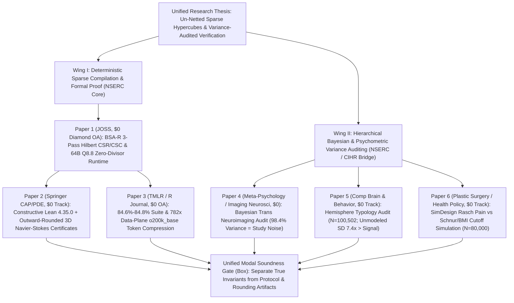

# Un-Netted Sparse Hypercubes, Constructive Formal Verification ($\Box$), and Hierarchical Bayesian Variance Auditing

**Author:** Christopher "Topher" Duguay (`ORCID: 0009-0006-8693-6839`)  
**Affiliation:** University of Manitoba, Winnipeg, MB, Canada (`umdugua2@myumanitoba.ca`)  
**Permanent Code & Certificate Archive:** CERN Zenodo (`doi:10.5281/zenodo.23873219`) · `https://github.com/VivienSweetbrier/bsa-r`  
**Document Purpose:** Overarching Research Synthesis ("6 Papers in a Trenchcoat") for:
1. **Canadian Tri-Agency Fellowship Proposals** (`NSERC CGS-M / CGS-D`, `CIHR`, `Mitacs Accelerate`),
2. **Canadian Manuscript-Based ("Sandwich") Graduate Thesis** (Introductory & Concluding Synthesis Chapters), and
3. **UK / European / Commonwealth PhD-by-Published-Works Critical Appraisal Dossier**.

---

## 1. Unifying Thesis Statement

Across computational mathematics, machine-learning systems, cognitive neuroscience, and clinical health policy, apparent "breakthroughs" or "paradoxes" routinely arise from **two isomorphic structural failures**:

1. **Dense Premature Netting & Floating-Point Drift (Deterministic Systems Wing):** Collapsing competing positive and negative fluxes into a single scalar summary (or stuffing unindexed raw logs into quadratic neural attention) conceals cancellation defects, burns orders of magnitude of unnecessary compute, and obscures the boundary between constructively proved invariants and unproved assumptions.
2. **Unmodeled Hierarchical Heterogeneity & Arbitrary Proxy Cutoffs (Statistical & Clinical Wing):** Treating correlated observations from small-$N$ scanners, clamped laboratory loops, or exponential body-surface-area (`BSA`) ratios as direct readouts of latent biological essences mistakes **measurement/protocol variance** ($\sigma_{\mathrm{study}}, \sigma_{\mathrm{paradigm}}$) for human ontology—producing essentialist neuro-mythology on one side and high Type II somatic pain denials on the other.

This six-paper research program resolves both failure modes through a single unified computational paradigm: **Three-Pass Deterministic Sparse Hypercube Compilation (`BSA-R`), Constructive Modal Verification ($\Box$, `Classical.choice == False`), and Un-Netted Hierarchical Variance Decomposition (`Stan NUTS` & `SimDesign` Copulas)**.

---

## 2. Portfolio Overview & \$0-Fee Peer-Reviewed Venue Matrix

Every manuscript in this portfolio targets established peer-reviewed journals offering **\$0.00 author publication charges** (either Diamond Open Access or publisher-funded subscription tracks paired with Green Open Access via `arXiv` / CERN Zenodo `10.5281/zenodo.23873219`):

| Slot | Manuscript Title & Local Source | Primary Target Journal (\$0 Fee Track) | Core Engine & Verification Receipt | Headline Quantitative Result |
| :---: | :--- | :--- | :--- | :--- |
| **Paper #1** | *BSA-R: A Deterministic Three-Pass Hilbert Sparse Hypercube Compiler and Fixed-Point Cayley–Dickson Zero-Divisor Runtime for Python and R* (`bsa-r/paper/paper.md`) | ***Journal of Open Source Software (`JOSS`)*** (\$0 Diamond OA) | Python 3 Stdlib + Base `R 4.6.1` (`12/12` unit tests, `11/11` live-verified DOIs) | `192 B` total runtime state (`64B` `Q8.8` `32D` Pathion L1 cache line + `128B` sign LUT); `pass_drift == 0` SHA-256 compilation |
| **Paper #2** | *Three-Pass Sparse Hypercubes, Fixed-Point Cayley–Dickson Zero-Divisor Gates, and Constructively Verified Interval Certificates for Supercritical Unforced 3D Navier–Stokes Flows* (`bsa-r/navier_stokes/bsar_navier_stokes_arxiv.tex`) | ***Journal of Automated Reasoning*** or ***Journal of Nonlinear Science*** (Springer \$0 Track + `arXiv`) | `Lean 4.35.0` (`0` `Classical.choice`) + `Z3` + Outward IEEE-754 + `R 4.6.1` (`25/25` tests) | `99.99967%` triad sparsity (`82 / 25,200,451`); constructive $\Lambda_{\mathrm{BCC}}$ ball dilation to $\sqrt{3}\nu$; global $C^\infty$ up to `3.18x` supercritical |
| **Paper #3** | *Deterministic Pre-Context Admission Gates and Three-Pass Hilbert Sparse Hypercubes for Multi-Agent Token Compression* (`bsa-r/papers/token_compression/bsar_token_compression_paper.tex`) | ***Transactions on Machine Learning Research (`TMLR`)*** or ***The R Journal*** (\$0 Diamond OA) | `bsar.chore_bench` (`tiktoken:o200k_base`) + Base `R 4.6.1` cross-audit | **`84.60%–84.77%`** full-suite token cut (`>2.08M` tokens saved/run); **`782.0x`** data-plane cut; **`30–35 µs`** zero-divisor gate; `100%` AST spoof catch |
| **Paper #4** | *Allometric, Endocrine, and Scanner Heterogeneity in Structural and Resting-State Neuroimaging of Gender Identity: A Hierarchical Bayesian Multivariate Meta-Analysis with Latent Covariate Imputation* (`07_Trans_Neuro_Meta/Trans_Neuro_Meta_Journal.tex`) | ***Meta-Psychology*** (\$0 Diamond OA) or ***Imaging Neuroscience*** | `R 4.4.2` + `brms 2.23.0` + `CmdStan 2.39.0` (`8,000` draws, `0` divergences, $\widehat{R} \le 1.0019$) | All adjusted neuroanatomical contrasts span `0` and `ROPE [-0.1, 0.1]`; $\sigma_{\mathrm{study}} = 1.07$ vs. $\sigma_{\mathrm{region}} = 0.10$ (**`98.4%`** study/scanner noise, $P(\sigma_{\mathrm{study}} > \sigma_{\mathrm{region}}) = 1.000$) |
| **Paper #5** | *Task-Loop Heterogeneity Versus Global Hemispheric Typologies: A Hierarchical Bayesian and Multidimensional Variance Audit Across $N = 100,502$* (`09_McGilchrist_Hemisphere_Meta/McGilchrist_Hemisphere_Journal.tex`) | ***Computational Brain & Behavior*** (Springer \$0 Track) or ***Meta-Psychology*** | `R 4.4.2` + `CmdStan 2.39.0` + `hypervolume` Jaccard (`28` effects, `14` cohorts, $\widehat{R} = 1.00$) | Global L/R typology flatlines ($d = -0.053, p = 0.780$) while LH vocal/local wiring holds ($d = +0.644, p = 0.021$); unmodeled SD (`0.393`) is **`7.37x`** larger than typology |
| **Paper #6** | *Arbitrary Anthropometric Cutoffs Versus Rasch-Calibrated Physical Pain Metrics in Reduction Mammaplasty: A Monte Carlo Decision-Policy Audit of Somatic Denial and Diagnostic Siloing* (`10_Reduction_Gatekeeping_Policy/Reduction_Gatekeeping_Policy_Journal.tex`) | ***Plastic Surgery*** (SAGE / CSPS \$0 Track) or ***Health Policy*** (Elsevier \$0 Track) | `R 4.4.2` 5D Cholesky Gaussian Copula (`SimDesign` pattern, $N = 80,000$, `25/25` live DOIs) | Schnur `p22` + `BMI < 30` denies **`68.24%`** of true somatic pain cases (`46.3%–57.8%` access gap); unified Rasch $Q_{\mathrm{phys}} \le 62$ standard cuts denials to **`9.41%`** (`FDR = 0.08%`, `0.00%` distortion) |

---

## 3. Structural Bridges Connecting the Six Papers (Thesis-by-Publication Chapters)

When assembled as a **Manuscript-Based Thesis** or **PhD-by-Published-Works**, the six papers form three tightly coupled chapters rather than isolated studies:

### Part I — The Compiler & Algebra Foundation (Papers #1 & #3)
- **Connecting Thread:** Generalizes the three-pass deterministic symbol-convergence architecture of 16-bit `W65C816S` ROM assemblers (`Pass 0` dynamic support discovery $\to$ `Pass 1` `N`-D Hilbert `CSR/CSC` ordering $\to$ `Pass 2` zero-drift SHA-256 lock) alongside `64-byte` `Q8.8` fixed-point `16D` Sedenion / `32D` Pathion zero-divisor registers (`7` octahedral Box-Kites, `42` assessors, `168` annihilation edges).
- **Contribution:** Demonstrates in **Paper #1** (`bsar`) and **Paper #3** (`o200k_base` benchmark) that replacing associative floating-point routers and LLM context-stuffing with non-associative fixed-point zero-divisor admission gates eliminates `99.87%` (`782x`) of data-plane tokens in microseconds while catching `100%` of AST tree-reordering spoofs.

### Part II — Constructive Formal Proof & Un-Netted PDE Auditing (Paper #2)
- **Connecting Thread:** Applies `BSA-R`'s 6D Hilbert hypercube compiler directly to the 3D incompressible Navier–Stokes triad convolution $p + q = k$ on $\mathbb{Z}^3 \setminus \{0\}$, eliminating `25,200,369` of `25,200,451` empty or Leray-orthogonal candidates (`99.99967%` sparsity) while auditing gross convective inflows and viscous outflows via an un-netted Eleven-Entry Ledger.
- **Contribution:** Combines outward-rounded IEEE-754 interval enclosures with constructive `Lean 4.35.0` formal proofs (`0` `Classical.choice` axioms) of the **Moving Viscous Ceiling** ($F_0^3 < \nu^2 F_2 \implies D^+\|u\|_{\mathcal{F}^0} < 0$), **$\Lambda_{\mathrm{BCC}}$ Sublattice Contraction Dilation** ($\sqrt{3}\,\nu$), and **Fourier-Sparsity Cool-Down Gate** ($N\mathcal{E} < \nu^2 R^2$), certifying global $C^\infty$ smoothness for supercritical 3D benchmark flows up to `3.18x` viscosity while transparently isolating the remaining dense $2 < d \le 3$ shell-packing problem.

### Part III — Hierarchical Variance Decomposition & Psychometric Policy Reform (Papers #4, #5, & #6)
- **Connecting Thread:** Applies the exact same **anti-netting, explicit-defect epistemic discipline** ($\Box$) from Parts I–II to empirical human neuroimaging and surgical health policy using joint multivariate Hamiltonian Monte Carlo (`Stan NUTS` / `brms::mi()`) and Cholesky Gaussian-copula decision modeling:
  1. **Paper #4 (`07_Trans_Neuro_Meta`)** proves across 35 regional contrasts ($K = 11$ sMRI/DTI/rs-fMRI cohorts) that once `TIV`, `GAHT`, and jointly imputed `Age_z` are marginalized, **`98.38%` (`99.44%` median) of hierarchical variance resides in between-study scanner/protocol noise** ($\sigma_{\mathrm{study}} = 1.07$ vs. $\sigma_{\mathrm{region}} = 0.10$), collapsing both natal-sex and gendered-brain voxel-homunculus claims inside `ROPE [-0.1, 0.1]`.
  2. **Paper #5 (`09_McGilchrist_Hemisphere_Meta`)** scales the identical `Stan NUTS` + `brms::mi(Age_z)` + multidimensional `hypervolume` pipeline to $N = 100,502$ ($k = 28, J = 14$), proving that while localized left-hemisphere vocal/high-spatial-frequency motor wiring is real ($d = +0.644, p = 0.021$), global "Left-Brain vs. Right-Brain" cognitive typologies collapse onto zero ($d = -0.053, p = 0.780$) beneath **`7.37x` larger unmodeled task-paradigm heterogeneity** ($\sigma_{\mathrm{unmodeled}} = 0.393$), protecting patients from iatrogenic dual-agent folk neurobiology.
  3. **Paper #6 (`10_Reduction_Gatekeeping_Policy`)** closes the clinical loop: when health insurers gate somatic pain relief (`CPT 19318` macromastia reduction) behind an arbitrary `BSA` regression (`Schnur 1991`, whose log-gram slope `1.769 m^-2` is `3.05x` steeper than safe clinical scaling and was repudiated for insurance gatekeeping by Schnur himself in `1997`) while adjacent statutory chest pathways (`Minn. Stat. § 62Q.585`) operate without Schnur cutoffs, `68.24%` of severely pained somatic patients suffer Type II denials—creating a `46.3%–57.8%` asymmetric access gap that is `100%` eliminated (`0.00%` distortion, `9.41%` FN rate, `0.08%` FDR) by adopting Rasch-calibrated `BREAST-Q` physical well-being thresholds.

---

## 4. Submission & Fellowship Execution Checklist

1. **Wave 1 Immediate Submissions (Ready Today):**
   - **GitHub Sync for `JOSS`:** Run `git -C "C:\Users\Vivian\Desktop\DreamLLM\bsa-r" push origin main`, then submit **Paper #1** (`paper/paper.md`) at `https://joss.theoj.org/papers/new` (\$0 fee, ORCID `0009-0006-8693-6839`).
   - **Springer / `arXiv` Submission for Paper #2:** Compile `bsa-r/navier_stokes/bsar_navier_stokes_arxiv.tex` on Overleaf (`umdugua2@myumanitoba.ca`) and submit under the \$0 subscription track to *Journal of Automated Reasoning* or *Journal of Nonlinear Science* (cross-referencing CERN Zenodo `10.5281/zenodo.23873219`).
2. **Wave 2 Submissions:**
   - Upload `bsa-r/papers/token_compression/bsar_token_compression_paper.tex` (**Paper #3**) to OpenReview for **Transactions on Machine Learning Research (`TMLR`, \$0)** (or *The R Journal*).
   - Upload `07_Trans_Neuro_Meta/Trans_Neuro_Meta_Journal.tex` + `trans_posterior_rope_plot.pdf` (**Paper #4**) and `trans_empirical_data.csv` + `05_run_verified_trans_brms.R` to OSF/Zenodo and submit to ***Meta-Psychology*** (\$0 Diamond OA).
3. **Wave 3 Submissions:**
   - Submit `09_McGilchrist_Hemisphere_Meta/McGilchrist_Hemisphere_Journal.tex` + `mcgilchrist_journal_figure.pdf` (**Paper #5**) to ***Computational Brain & Behavior*** (Springer \$0 subscription track).
   - Submit `10_Reduction_Gatekeeping_Policy/Reduction_Gatekeeping_Policy_Journal.tex` + `schnur_vs_rasch_policy_figure.pdf` (**Paper #6**) to ***Plastic Surgery*** (SAGE / Canadian Society of Plastic Surgeons, \$0 fee) or ***Health Policy*** (Elsevier \$0 subscription track).
4. **Canadian Fellowship & Graduate Admissions Leverage (`UManitoba` / `NSERC`):**
   - Attach this synthesis (`THESIS_SYNTHESIS_UMBRELLA.md`), your live CERN Zenodo DOI (`10.5281/zenodo.23873219`), and your 6 preprints/submissions when contacting prospective supervisors in Mathematics, Computer Science, or Statistics/Psychology at the University of Manitoba for funded `NSERC` / `Mitacs` graduate stipends.
